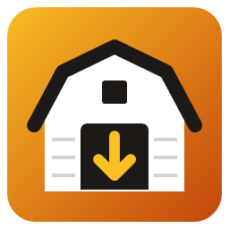
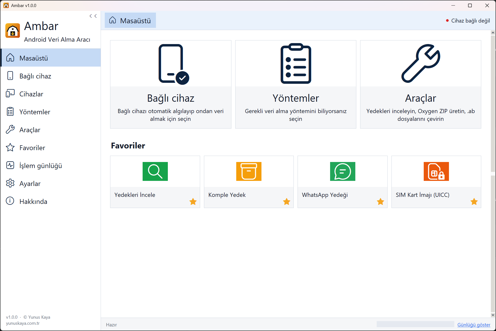
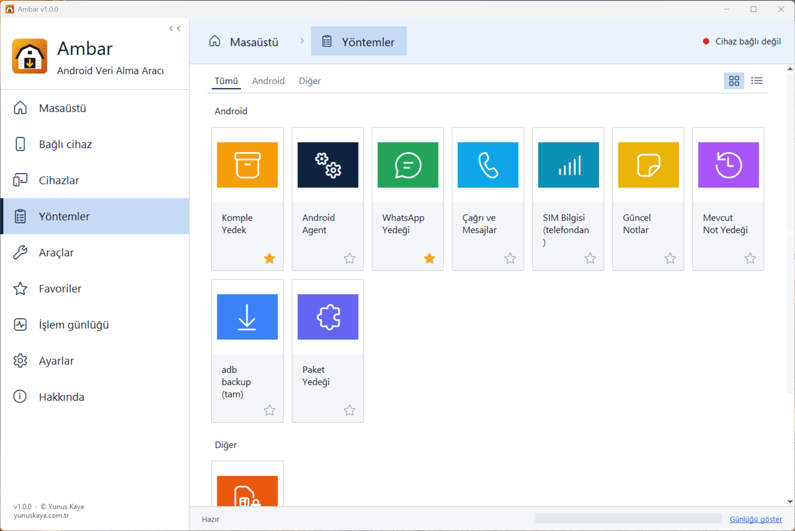
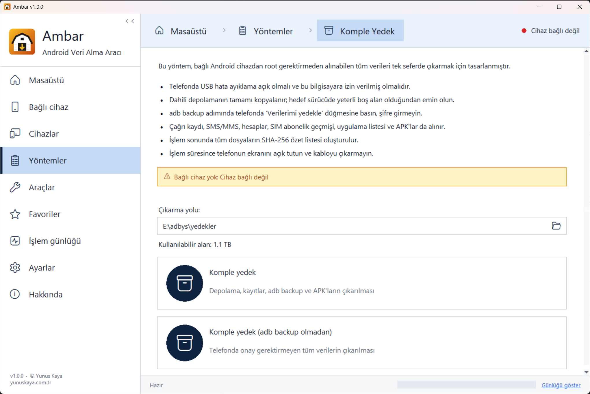
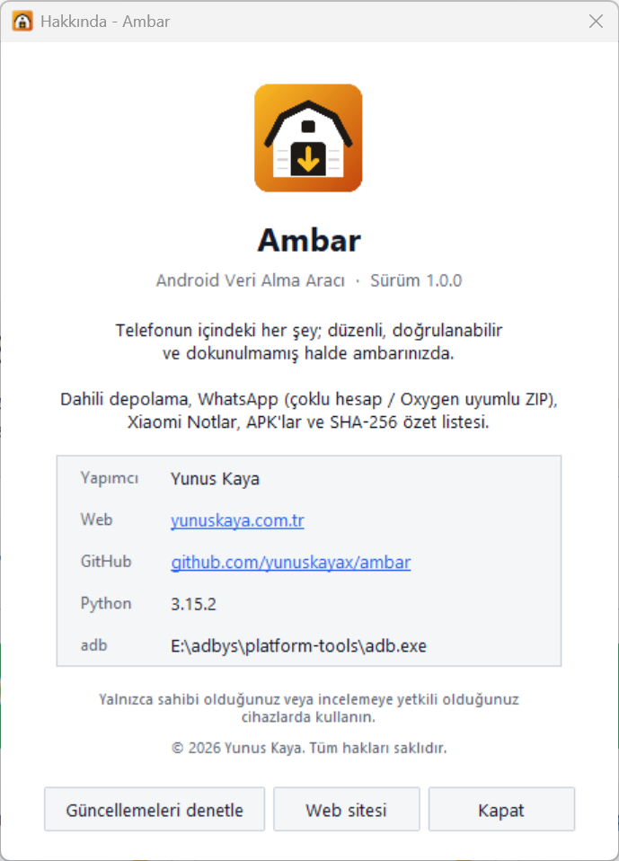

<div align="center">



# Ambar

**Android Veri Alma Aracı**

Android telefonlardan ADB ile tek tıkla veri alın: telefonun içindeki her şey düzenli, doğrulanabilir ve dokunulmamış halde ambarınızda.

Dahili depolama · Rehber, takvim ve MMS ekleri (Agent) · WhatsApp (çoklu hesap, Oxygen uyumlu) · SIM / UICC · Xiaomi Notlar · APK'lar · SHA-256


[yunuskaya.com.tr](https://yunuskaya.com.tr)

<br>

### [⬇ Ambar.exe'yi indir](https://github.com/yunuskayax/ambar/releases/latest/download/Ambar.exe)

Windows 10 / 11 · Kurulum gerekmez · Tek dosya

</div>

---

<p align="center">
  
</p>

## Program arayüzü

Soldaki menü programın tamamını kapsar, üstteki yol çubuğu nerede olduğunuzu gösterir, sağ üstteki nokta ise cihazın bağlı olup olmadığını.

| Sayfa | İçerik |
|---|---|
| **Masaüstü** | Bağlı cihaz, Yöntemler ve Araçlar kısayolları ile favori kartlarınız |
| **Bağlı cihaz** | Telefonun üretici, model, Android sürümü, IMEI, seri no, yonga seti, güvenlik yaması gibi bilgileri ve doğrudan o cihazdan veri alma kartları |
| **Cihazlar** | Bağlı cihaz, yedeklerde görülen cihazlar ve marka profilleri; her biri için hangi yöntemlerin desteklendiği listelenir |
| **Yöntemler** | Tüm veri alma yöntemleri; Tümü / Android / Diğer sekmeleri, ızgara veya liste görünümü |
| **Araçlar** | Yedekleri İncele, Oxygen ZIP Üret, .ab → .tar ve kayıt klasörü |
| **Favoriler** | Kartların köşesindeki ☆ ile eklediğiniz yöntemler; Masaüstünde de görünür |
| **İşlem günlüğü** | Çalışan işlemin canlı çıktısı. Alt çubuktaki ilerleme çubuğu ve "Günlüğü göster" bağlantısı her sayfadan erişilebilir |
| **Ayarlar** | Kayıt klasörü, favorileri sıfırlama, sürüm / adb / ayar dosyası bilgileri |
| **Hakkında** | Sürüm bilgisi ve güncelleme denetimi |

<p align="center">
  
</p>

Bir yöntem kartına tıklandığında işlem hemen başlamaz. Önce yöntemin ne yaptığı, gereksinimleri, çıkarma yolu (Gezgin görünümlü klasör seçici) ve hedef sürücüdeki kullanılabilir alan aynı sayfada gösterilir; telefon bağlı değilse uyarı verilir. İşlem, sayfanın altındaki eylem kartıyla başlar.

<p align="center">
  
</p>

## Özellikler

| İşlem | Açıklama |
|---|---|
| **Yedekleri İncele** | Alınan yedekleri tarayıcıda açan inceleme programı: cihaz bilgisi, çağrılar, mesajlar, kişiler, dosyalar, fotoğraf/video galerisi, zaman çizelgesi, istatistik, genel arama, delil etiketleme ve yazdırılabilir rapor |
| **Komple Yedek** | Cihaz bilgileri, çağrı kaydı, SMS/MMS, `adb backup`, tüm dahili depolama (`/sdcard`), yüklü uygulamaların APK'ları ve tüm dosyaların SHA-256 özet listesi |
| **Android Agent** | Telefona geçici olarak kurulan küçük bir ajan uygulamasıyla (`com.ambar.agent`, 16 KB) adb'nin tek başına okuyamadığı verileri çıkarır: **rehber** (kişi fotoğrafları, e-posta, kurum, adres, not, doğum günü, hesap), **takvim** (katılımcı ve hatırlatmalarla), çağrı kaydı, SMS, **MMS ekleri**, tüm uygulamaların gerçek adları ve simgeleri, hesaplar, eşleşmiş Bluetooth cihazları. İzinler `adb install -g` ile kurulumda verilir; ajanın internet izni yoktur, veri yalnızca USB üzerinden (adb yönlendirmesi + oturum anahtarı) aktarılır. İşlem sonunda ajan telefondan kaldırılır. Ham sağlayıcı satırları `agent/ham/*.jsonl` olarak saklanır |
| **Çağrı ve Mesajlar** | Yalnızca çağrı kaydı, SMS ve MMS'i saniyeler içinde alır |
| **SIM Kart İmajı (UICC)** | USB SIM / akıllı kart okuyucudaki (PC/SC, CCID) kartın dosya sistemini çıkarır: ICCID, IMSI, kendi numarası, operatör, rehber (ADN ve USIM telefon defteri), FDN/SDN, son aranan numaralar, SIM'deki SMS'ler, son konum (LOCI/PSLOCI/EPSLOCI), yasaklı / tercih edilen ağlar. 2G SIM ve 3G/4G USIM desteklenir. Kart yalnızca okunur; PIN'in kalan deneme hakkı 1 ise PIN gönderilmez. Tüm komutlar `uicc_apdu.txt`'e kaydedilir |
| **SIM Bilgisi (telefondan)** | Telefona takılı ve daha önce takılmış tüm SIM kartların kaydı (operatör, numara, ICCID, IMSI, Wi-Fi arama), SIM rehberi ve SIM SMS'leri. İnceleme ekranında çağrı ve mesajların hangi SIM'den yapıldığı gösterilir |
| **WhatsApp Yedeği** | `com.whatsapp` klasörünü otomatik bulur ve dosya tarihlerini koruyarak çeker. Çoklu hesapta her hesap için ayrı, **Oxygen Forensic** ile açılabilen ZIP üretir |
| **Güncel Notlar** | Telefonda MIUI yedekleme ekranını açar, yeni not yedeğini otomatik algılar ve notları `notlar.txt` / `notlar.json` olarak kaydeder |
| **Mevcut Not Yedeği** | Telefondaki en son MIUI not yedeğini (`Notlar(com.miui.notes).bak`) çeker ve çözer |
| **adb backup (tam)** | Klasik `.ab` yedeği; telefonda onay gerekir |
| **Paket Yedeği** | Tek bir uygulamanın `.ab` yedeği |
| **Oxygen ZIP Üret** | Daha önce çekilmiş bir WhatsApp klasöründen hesap başına ZIP oluşturur |
| **.ab → .tar** | Şifresiz `.ab` dosyasını açılabilir `.tar` arşivine çevirir |

Ek olarak:

- **Hatalarda durmayan kopyalama:** `adb pull` normalde okunamayan ilk dosyada tamamen durur. Bu araç sorunlu klasöre inip okunabilen her dosyayı alır, alınamayanları `cekilemeyenler.txt` dosyasına yazar.
- **Canlı ilerleme:** Kopyalanan boyut ve yüzde ekranda görünür.
- **Cihaz durumu:** Bağlı, izin bekliyor veya bağlı değil durumları renkle gösterilir.
- **IMEI:** Bağlı cihazın IMEI numaraları (çift SIM'de ikisi de) root olmadan okunur ve her yedeğin cihaz bilgisine yazılır. Önce telefonun abone bilgisi servisi denenir; olmazsa `*#06#` ekranı açılıp ekrandaki metin okunur. Yalnızca 15 haneli ve Luhn denetimini geçen değerler kabul edilir.
- **Uygulama simgeleri ve adları:** Yüklü uygulamaların kendi simgeleri ve (varsa Türkçe) görünen adları APK'nın tamamı çekilmeden, telefondaki `unzip` ile yalnızca kaynak tablosu ve simge dosyaları okunarak alınır. Klasik, uyarlanabilir (adaptive) ve vektör simgeler desteklenir; inceleme ekranında ve portable raporda gösterilir.
- **Dokunulmayan orijinal kopya:** Çekilen klasörler hiç değiştirilmez. Oxygen için gereken düzenleme yalnızca ZIP'in içinde yapılır.

## Yedekleri inceleme

**Yedekleri İncele** kartı (veya `python ambar.py incele`) kayıt klasöründeki yedekleri tarayıcıda açar. Program yalnızca bu bilgisayarda (`127.0.0.1`) çalışır, internet gerektirmez.

- **Cihazlar:** Aynı telefonun komple, WhatsApp, kayıt ve not yedekleri tek cihaz altında birleşir.
- **Cihaz paneli:** İstatistik, çıkarma bilgisi (başlangıç, bitiş, süre), sahip (hesaplar), **genel bilgi** (olay numarası, kanıt numarası, el koyma tarihi ve yeri, el koyan, mühür no vb. ve istenen kadar ek alan; raporların kapağına yazılır), cihaz bilgisi ve inceleyici notu.
- **WhatsApp sohbetleri:** WhatsApp sayfasında yedeğin yanındaki **Anahtar gir** ile 64 haneli uçtan uca yedek anahtarı (crypt15) veya anahtar dosyası (`encrypted_backup.key`, ya da root ile alınmış `key` — crypt12/14) girilirse sohbetler çözülüp WhatsApp görünümünde açılır; medyalar yedekteki dosyalarla eşleştirilir. Anahtar saklanmaz; çözülen veritabanı `%LOCALAPPDATA%\Ambar\incele\whatsapp` altına yazılır.
- **Genel bölümler:** Uygulamalar, Çağrılar, Dosyalar, Hesaplar, Kişiler, Mesajlar, Notlar ve Raporlar. Hepsinde arama, sıralama, sayfalama ve ayrıntı paneli var.
- **Analitik:** Genel arama, istatistik grafikleri, etiketli deliller, fotoğraf/video galerisi ve zaman çizelgesi.
- **Uygulamalar:** Verisi bulunan uygulamalar. WhatsApp için her hesabın mesaj yedekleri ve medya klasörleri ayrı gösterilir.
- **Delil etiketleme ve rapor:** Herhangi bir kayıt açıklamayla etiketlenebilir; özet rapor tarayıcıdan PDF olarak kaydedilebilir.

Dizin, etiketler ve notlar `%LOCALAPPDATA%\Ambar\incele` içinde tutulur; **delil klasörlerine hiçbir şey yazılmaz**.

> **Hesaplar:** Bazı ROM'lar (ör. MIUI) `dumpsys account` çıktısında hesap adlarını maskeler (`ahmet***5@gmail.com`). Ambar, hesap listesiyle birlikte diğer sistem dökümlerindeki adresleri de kaydeder (`kayitlar/hesap_kaynaklari.txt`); inceleme programı maskeli adı bunlarla eşleştirip tam adresi gösterir ve **Kaynak** sütununda nereden çözüldüğünü yazar. Eşleşme bulunamazsa "cihaz maskeledi" notu düşülür.

### Dışa aktarma sihirbazı

Cihaz sayfasındaki **Dışa aktar** düğmesi sihirbazı açar:

- **Genel:** Bölümler (cihaz bilgisi, çağrılar, mesajlar, kişiler, dosyalar, uygulamalar, hesaplar, notlar; etiketli deliller, zaman çizelgesi, istatistik), dosyası bulunan uygulamalar, klasör, dosya adı ve biçim. Seçenekler: dosyaları da aktar, yalnızca etiketli kayıtlar, her bölüm ayrı dosya.
- **Biçimler:** Ambar portable rapor (görüntüleyici dahil), HTML (tablo görünümü), PDF (Microsoft Edge ile), Excel (XLSX), CSV, JSON.
- **Dosyalar:** Aktarılacak dosya türleri; HTML/PDF'te görüntülerin küçük resmi.
- **Tarih filtreleri:** Başlangıç–bitiş aralığı.
- **Rapor bilgileri / Görünüş / Üstbilgi ve altbilgi:** Başlık, kurum, inceleyen, dosya no, açıklama, logo, tema rengi, sayfa yönü, üst/alt bilgi ve sayfa numarası. Ayarlar şablon olarak saklanır; **Önizle** raporu tarayıcıda gösterir.

Her dışa aktarmada klasöre `SHA256.txt` yazılır.

### Portable rapor (.ambx)

Sihirbazda **Ambar portable rapor** biçimi, seçilen verileri **tek bir dosyaya** yazar (Oxygen'in `.ofbx` dosyası gibi):

```
Raporlar\
├── Rapor.ambx          ← kayıtlar, dosya listesi, etiketler, olay bilgileri, özet ve TÜM dosyalar tek dosyada
├── Rapor.ambx.sha256   ← dosyanın SHA-256 özeti (sha256sum biçimi; TeraCopy vb. ile doğrulanabilir)
├── Rapor.ambx.md5      ← MD5 özeti
└── AmbarIncele.exe     ← görüntüleyici (adb / yedek alma yok), kurulum gerekmez
```

**.ambx biçimi:** `AMBARX` başlığı; ardından öğeler sıkıştırılmadan art arda (görüntüleyici dosyaları çıkarmadan, doğrudan okur — video sarma dahil); sonda zlib'li JSON dizin (her öğenin konumu, boyutu ve SHA-256 özeti) ve dizinin SHA-256'sını taşıyan kuyruk. Dosya tek geçişte yazılır; yarım kopyalanmış dosya açılışta tespit edilir. Ayrıntı: `ambar_ambx.py`.

- `AmbarIncele.exe` yanındaki `.ambx` dosyasını açar; ilk çalıştırmada `.ambx` uzantısını (yalnızca geçerli kullanıcı için) kendisiyle ilişkilendirir, böylece rapora çift tıklamak yeterli olur.
- Görüntüleyicideki **Bütünlüğü doğrula** düğmesi her öğenin özetini ve `.sha256` dosyasını tüm dosyayla karşılaştırır.
- Rapor salt okunur açılır; eklenen etiket ve notlar yanındaki `<ad>.inceleme.sqlite` dosyasına yazılır, rapor dosyasının özeti değişmez.
- Eski sürümlerin klasör biçimindeki raporları (`rapor.ambar` + `dosyalar\`) da açılır.

> **Kişiler:** Android, rehberin adb ile okunmasına izin vermez (`READ_CONTACTS`). Kişiler bölümü bu yüzden çağrı kaydı ve mesajlardaki isim/numara bilgilerinden türetilir.

## Kurulum

### Hazır program (önerilen)

1. **[Ambar.exe'yi indirin](https://github.com/yunuskayax/ambar/releases/latest/download/Ambar.exe).** Eski sürümler [Releases](../../releases) sayfasındadır.
2. İndirdiğiniz dosyayı bir klasöre (örneğin `Belgeler\Ambar`) taşıyın ve çift tıklayın.

Python, Android SDK veya adb kurmanız gerekmez; hepsi programın içindedir. Yedekler exe'nin bulunduğu klasördeki `yedekler\` klasörüne kaydedilir. Kayıt yerini **Ayarlar** sayfasından ya da her yöntem sayfasındaki **Çıkarma yolu** kutusundan değiştirebilirsiniz.

> **"Windows bilgisayarınızı korudu" uyarısı:** Program dijital olarak imzalanmadığı için Windows SmartScreen ilk açılışta bu uyarıyı gösterebilir. **Ek bilgi → Yine de çalıştır** seçeneğine tıklayın. Dosyanın değiştirilmediğini, Releases sayfasındaki `Ambar.exe.sha256` özetiyle karşılaştırarak doğrulayabilirsiniz:
>
> ```powershell
> Get-FileHash .\Ambar.exe -Algorithm SHA256
> ```

### Kaynak koddan

```bash
git clone https://github.com/yunuskayax/ambar.git
cd ambar
```

[Android SDK Platform-Tools](https://developer.android.com/tools/releases/platform-tools) paketini indirin ve `platform-tools` klasörünü proje klasörüne koyun ya da adb'yi PATH'e ekleyin.

```bash
python ambar_gui.py      # grafik arayüz
python ambar.py          # komut satırı menüsü
```

Ek Python paketi gerekmez; yalnızca standart kütüphane (tkinter dahil) kullanılır.

## Telefonun hazırlanması

1. **Ayarlar → Telefon hakkında** bölümünde **Yapım numarası**'na (Xiaomi'de **MIUI / HyperOS sürümü**) 7 kez dokunun. Geliştirici seçenekleri açılır.
2. **Ek ayarlar → Geliştirici seçenekleri** bölümünde **USB hata ayıklama**'yı açın.
3. Telefonu USB kablosuyla bağlayın, USB modunu **Dosya aktarımı** yapın.
4. Telefonda çıkan **"USB hata ayıklamaya izin verilsin mi?"** penceresini onaylayın.

Programın sağ üst köşesindeki cihaz göstergesi yeşile döndüğünde telefon hazırdır; **Bağlı cihaz** sayfasında telefonun bilgileri görünür.

## Komut satırı kullanımı

```bash
python ambar.py incele                 # yedekleri inceleme programını aç (tarayıcıda)
python ambar.py komple                 # çağrı/mesaj + adb backup + tüm /sdcard + APK'lar + SHA-256
python ambar.py kayitlar               # yalnızca çağrı kaydı, SMS ve MMS
python ambar.py whatsapp               # com.whatsapp klasörünü bul, çek, Oxygen ZIP üret
python ambar.py whatsapp --kaynak /sdcard/Yedek/com.whatsapp
python ambar.py notlar --yeni          # telefonda güncel not yedeği aldır, sonra çek
python ambar.py notlar                 # mevcut son not yedeğini çek
python ambar.py notlar --dosya "Notlar(com.miui.notes).bak"
python ambar.py backup [--paket com.whatsapp]
python ambar.py oxygen yedekler/<klasör>
python ambar.py ab2tar yedek.ab
python ambar.py -o D:/Yedekler komple  # farklı kayıt klasörü
```

`komple` komutu için `--ab-yok`, `--sdcard-yok`, `--apk-yok` ve `--ozet-yok` seçenekleriyle adım atlanabilir.

## Çıktı yapısı

```text
yedekler/
├── <model>_komple_<tarih>/
│   ├── cihaz_bilgisi/            getprop, paket listesi, hesaplar, depolama
│   ├── sdcard/                   dahili depolamanın kopyası
│   ├── apk/<paket>/*.apk
│   ├── <model>_tam_<tarih>.ab
│   ├── cekilemeyenler.txt        izin nedeniyle alınamayan dosyalar
│   └── SHA256_tum_dosyalar.txt
├── <model>_whatsapp_<tarih>/
│   ├── sdcard_Android_media_com.whatsapp/   orijinal kopya
│   ├── <...>_hesap_1001.zip                 Oxygen'e verilecek dosya
│   └── SHA256.txt
└── notlar_<tarih>/
    ├── notlar.txt
    ├── notlar.json
    └── Notlar(com.miui.notes).bak
```

## WhatsApp çoklu hesap ve Oxygen Forensic

WhatsApp'ta birden fazla hesap varsa ek hesabın verileri `WhatsApp/accounts/<id>/` altına yazılır. Oxygen Forensic veritabanını (`msgstore.db.crypt15`) bu konumda bulamaz. Program her hesap için ayrı bir ZIP üretir ve hesabın `Backups`, `Databases` ve `Media` klasörlerini ZIP içinde `WhatsApp/` köküne yerleştirir. Hesapların verileri birbirine karışmaz.

## Bilinen sınırlamalar

- **`adb backup`** Android 12 ve sonrasında çoğu uygulamanın verisini içermez. WhatsApp ise bu yöntemle yedeklenmeye hiçbir sürümde izin vermez. WhatsApp için klasör yedeğini kullanın.
- **`Android/data` ve `Android/obb`** Android 11 ve sonrasında korunur; root olmadan içerikleri alınamaz.
- **WhatsApp mesaj yedekleri** (`.crypt14` / `.crypt15`) şifrelidir. İnceleme programı 64 haneli anahtar veya anahtar dosyasıyla çözer; uçtan uca yedekte anahtar yerine **parola** seçildiyse yedek WhatsApp sunucusu olmadan çözülemez.
- **Not yedekleri** MIUI / HyperOS yerel yedekleme biçimine göre çözülür. Başka marka not uygulamaları desteklenmez.
- Şifreli `.ab` ve MIUI yedekleri çözülmez; yedeği alırken şifre koymayın.
- **SIM bilgisi (telefondan):** Android 14 ve sonrası ICCID, IMSI ve numaranın son hanelerini maskeler; tam değerler için kartı kart okuyucuyla (UICC) okuyun. SIM kart imajında rehber, SMS ve konum dosyaları için kartın PIN'i gerekir (PIN kapalıysa gerekmez). eSIM okunamaz.

## Exe derleme

```powershell
powershell -ExecutionPolicy Bypass -File build.ps1
```

Betik, adb yoksa Google'dan indirir, PyInstaller'ı kurar, sürüm numarasını `ambar.py` içindeki `SURUM` değerinden alır ve `dist\Ambar.exe` ile `dist\Ambar.exe.sha256` dosyalarını üretir. Gömülü adb, programın ilk açılışında `%LOCALAPPDATA%\Ambar\platform-tools` klasörüne kopyalanır.

### Yeni sürüm yayınlama

Sürümler GitHub Actions ile otomatik derlenir ve yayınlanır:

1. `ambar.py` içindeki `SURUM` değerini artırın (örneğin `1.1.0`).
2. Değişikliği gönderin ve aynı numarayla bir etiket oluşturun:

   ```bash
   git tag v1.1.0
   git push origin v1.1.0
   ```

3. [`.github/workflows/release.yml`](.github/workflows/release.yml) exe'yi Windows sunucusunda derler ve Releases sayfasına yükler. README'deki indirme bağlantısı her zaman en son sürümü gösterir.

Simge `tools/make_icon.ps1` ile üretilir.

## Proje yapısı

| Dosya | Görev |
|---|---|
| `ambar.py` | Tüm veri alma işlemleri ve komut satırı arayüzü |
| `ambar_gui.py` | tkinter grafik arayüz |
| `ambar_incele.py`, `incele/index.html` | Yedek inceleme programı (yerel sunucu ve tarayıcı arayüzü), portable rapor dışa aktarma |
| `ambar_whatsapp.py` | WhatsApp yedek şifre çözme (crypt12/14/15) ve sohbet okuma |
| `ambar_agent.py`, `agent/` | Android Agent: bilgisayar tarafı (kurulum, protokol, ayrıştırma) ve ajan uygulamasının kaynağı (`agent/src`, `AndroidManifest.xml`); `agent/derle.py` APK'yı Gradle olmadan derler (JDK 17 ve build-tools yoksa `.arac/` altına indirir) |
| `ambar_simge.py` | Uygulama simgesi ve adı: ikili AndroidManifest / resources.arsc çözümü, VectorDrawable → SVG |
| `ambar_destek.py` | Cihaz → desteklenen yöntemler (Cihazlar sayfası) |
| `ambar_sim.py` | SIM kart imajı: PC/SC (WinSCard) üzerinden SIM/USIM okuma ve çözümleme |
| `ambar_ambx.py` | Tek dosya rapor biçimi (.ambx): yazıcı, okuyucu, bütünlük doğrulama |
| `ambar_rapor.py` | Dışa aktarma motoru (portable, HTML, PDF, XLSX, CSV, JSON) ve rapor şablonu |
| `ambar_incele_portable.py` | `AmbarIncele.exe` giriş noktası (yalnızca portable rapor görüntüleyici) |
| `build.ps1` | Tek komutla exe derleme |
| `.github/workflows/release.yml` | Etiket gönderildiğinde otomatik derleme ve yayın |
| `icon.ico`, `icon.png`, `tools/make_icon.ps1` | Uygulama simgesi ve üreteci |
| `docs/` | README görselleri |

## Yasal uyarı

Bu aracı yalnızca **sahibi olduğunuz** veya **incelemeye yasal olarak yetkili olduğunuz** cihazlarda kullanın. Yedekler kişisel ve hassas veriler içerir; güvenli bir yerde saklayın ve yetkisiz kişilerle paylaşmayın.

## Yapımcı

**Yunus Kaya** · [yunuskaya.com.tr](https://yunuskaya.com.tr) · [GitHub](https://github.com/yunuskayax/ambar)

Hata bildirimi ve öneriler için [Issues](https://github.com/yunuskayax/ambar/issues) sayfasını kullanabilirsiniz.

<p align="center">
  
</p>

© 2026 Yunus Kaya. Tüm hakları saklıdır.
